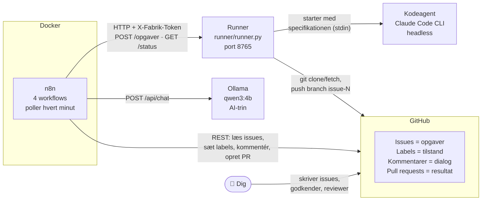
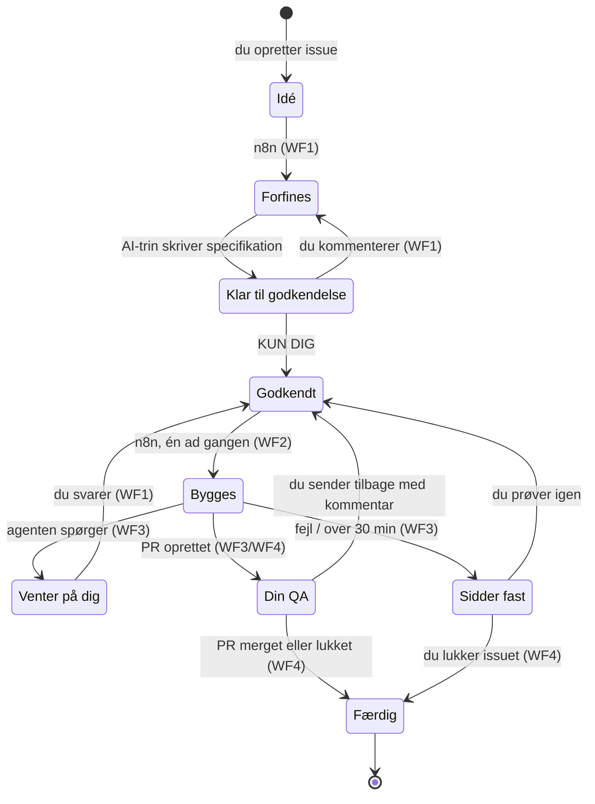

# Arkitektur

## Overblik

| Del | Ansvar | Hvorfor sådan |
|---|---|---|
| **GitHub** | Al tilstand: issue = specifikation, label = tilstand, kommentarer = spørgsmål og svar, PR = resultat | Én kilde til sandheden. Alt kan ses og auditeres i browseren, og der er ingen database at holde i sync |
| **n8n** | Orkestrator: poller GitHub, kører AI-trinnet, flytter labels, skriver kommentarer, opretter PR'er | Visuelt og let at demonstrere. GitHub kan ikke kalde n8n på en laptop, så n8n poller hvert minut |
| **Ollama** | AI-trinnet (forfining) | Gratis og lokalt styret. Opgaven er tekstomskrivning, ikke kode, så en mindre model er nok. `format: json` giver struktureret output |
| **Runner** | Det n8n ikke kan: git checkout, start af agent, 30-min timeout, push | Lille Python-program uden afhængigheder. Svarer med det samme (202) og arbejder i baggrunden. Tilstanden gemmes i `tilstand.json`, så et genstart ikke mister resultater |
| **Kodeagent** | Bygger opgaven på branch `issue-N` | Claude Code i headless-tilstand (`-p --output-format json`) med en eksplicit liste over tilladte værktøjer |

## Tilstandsmaskine

## n8n-workflows

| # | Fil | Overgange |
|---|---|---|
| 1 | `n8n/workflows/1-forfin-opgave.json` | Idé → Forfines → Klar til godkendelse · Klar til godkendelse + din kommentar → forfin igen · Venter på dig + dit svar → Godkendt |
| 2 | `n8n/workflows/2-start-opgave.json` | Godkendt → Bygges (kun dine issues, kun når intet andet bygges, og runneren er ledig) |
| 3 | `n8n/workflows/3-hent-resultater.json` | Bygges → Din QA (opretter PR) / Venter på dig / Sidder fast |
| 4 | `n8n/workflows/4-foelg-pull-requests.json` | PR åbnet manuelt → Din QA · PR merget → Færdig · PR lukket → Færdig · issue lukket → Færdig |

**Hvordan n8n kender sine egne kommentarer:** n8n og du bruger samme GitHub-konto, så forfatteren kan ikke skelne. Alle kommentarer fra fabrikken starter derfor med en skjult markør `<!-- fabrik:... -->`. En kommentar uden markør er din.

**Kobling PR ↔ opgave:** branchen hedder `issue-N`, og PR-beskrivelsen indeholder `Closes #N`.

## Runnerens HTTP-API

| Metode | Sti | Svar |
|---|---|---|
| GET | `/helbred` | `{ok: true}` (ingen token) |
| GET | `/status` | `{aktiv, ledig, resultater: [...]}` |
| POST | `/opgaver` | `{issue, titel, opgave}` → 202, eller 409 hvis optaget |
| POST | `/resultater/{issue}/kvitter` | n8n har håndteret resultatet, og runneren glemmer det |

Et resultat indeholder `status` (`faerdig` / `spoergsmaal` / `sidder_fast`), `opsummering`, `tests`, `spoergsmaal`, `commits`, `filer`, `varighed_sek`, `pris_usd`, `antal_ture` og `log_hale`. Hver kørsel logges også i `runner/logs/koersler.jsonl` til brug i evalueringen.

## Sikkerhed og rettigheder

| Hvem | Må | Må ikke |
|---|---|---|
| **AI-trinnet** | Skrive en specifikation og stille spørgsmål | Godkende: kun du sætter `Godkendt` |
| **n8n** | Læse issues, sætte labels (undtagen at godkende nye opgaver), kommentere, oprette PR | Merge. Kun opgaver skrevet af `forfatter` behandles |
| **Runner** | Klone, checke ud, committe, pushe branch `issue-N` | Pushe til `main`. Pushe filer, der ligner hemmeligheder (`.env`, `*.pem`, `id_rsa` …) |
| **Kodeagent** | Læse og redigere filer, køre `python`/`pytest`, `git add/commit/diff/status/log` | Netværk (WebFetch/WebSearch/curl), `git push/checkout/reset/rebase/remote`, `rm -rf`. Max 30 min og 80 ture |
| **Dig** | Godkende, svare, reviewe, merge, importere workflows i n8n | – |

Yderligere: runneren kræver en delt hemmelighed (`X-Fabrik-Token`) på alle kald, og agenten arbejder i en separat klon (`runner/arbejde/repo`), så den aldrig rører din egen arbejdskopi. `main` bør beskyttes med en branch protection rule på GitHub, så merge kræver en PR.
